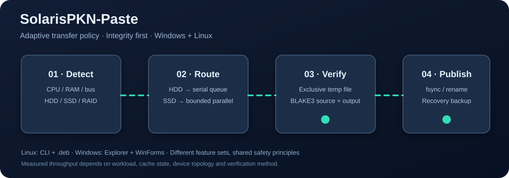
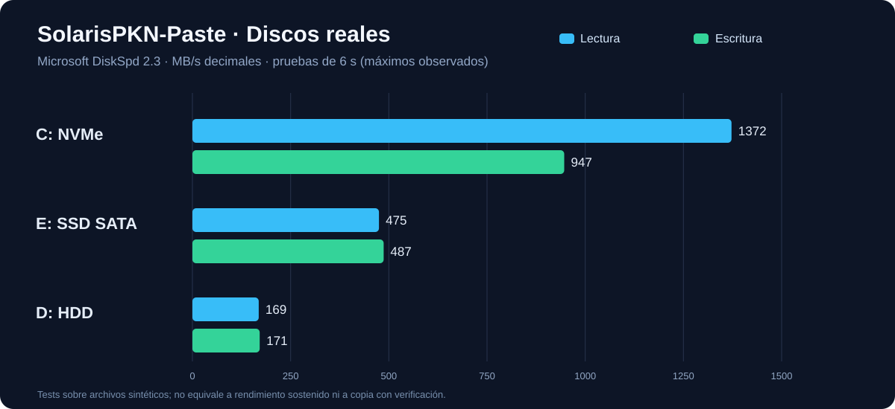
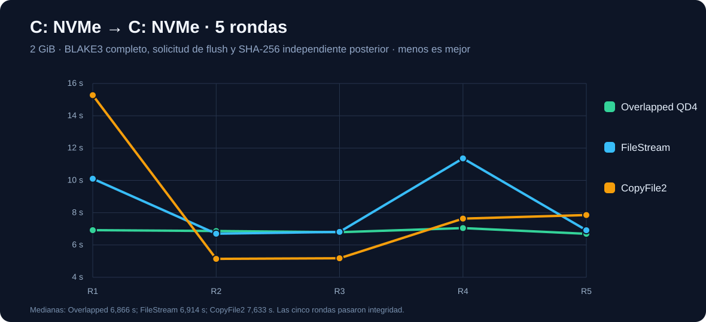
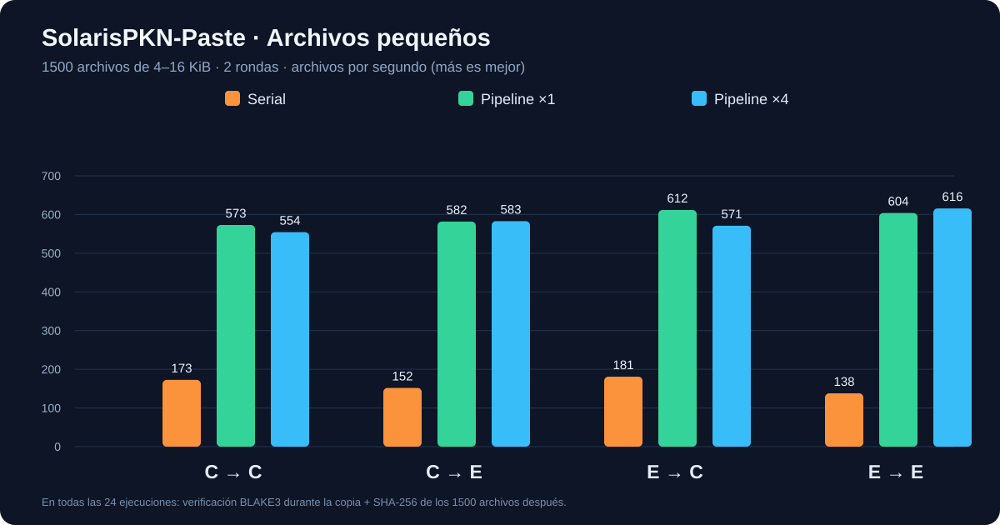
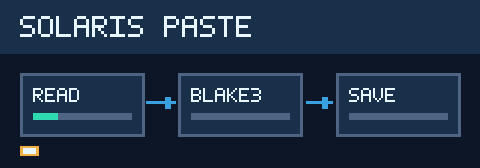

# ⚡ SolarisPKN-Paste

**[English](README.md) | [Español](README.es.md)**

> Vista previa experimental; todavía no apta para datos críticos. Módulo de [SolarisPKN-OS](../), junto a [SolarisPKN-Verity](../solarispkn-verity/). SolarisPKN-OS no es todavía una distribución instalable.

Un motor de copia con verificación de integridad y selección según CPU, RAM, HDD, SSD y RAID. Son **dos implementaciones diferentes**: Windows (.NET 10 WinForms con Explorador) y Linux (CLI Python 3 empaquetada como .deb para Debian/Ubuntu).

## 📥 Instalación rápida

**Windows:** Descargá el instalador autocontenido **SolarisPKN-Paste-Setup.exe** desde los artefactos de la última ejecución correcta de [GitHub Actions](https://github.com/SolarisPKN/SolarisPKN-OS/actions/workflows/solarispkn-paste.yml). Elegí **Standard (solo usuario/HKCU, sin UAC)** o **Advanced (todos los usuarios/HKLM, con UAC)**. El segundo permite copias explícitamente elevadas en carpetas protegidas y muestra los privilegios reales del proceso, pero **el servicio de aceleración privilegiada firmado todavía no está implementado**. Standard conserva FileStream, OVERLAPPED, CopyFile2 y E/S sin búfer cuando el sistema permite esas operaciones. [Matriz real de permisos](docs/WINDOWS-PRIVILEGES-SETUP.md).

**Debian/Ubuntu (instalación fácil):** [Descargá el pequeño instalador del repositorio SolarisPKN](https://github.com/SolarisPKN/SolarisPKN-OS/raw/refs/heads/main/apt/bootstrap/solarispkn-repository_1.0-1_all.deb). Desde Descargas:

~~~bash
sudo apt install ./solarispkn-repository_1.0-1_all.deb
sudo apt update && sudo apt install solarispkn-paste
~~~

El paquete incorpora la clave pública de firma y la fuente APT con Signed-By, sin curl, GPG ni editar sources.list. [Más detalles y alternativa directa de un solo comando](../packaging/apt/README.md).

Luego las actualizaciones llegan con apt update/upgrade. **No es un repositorio oficial** de Debian/Ubuntu; usa una clave propia verificada y Signed-By sin desactivar las firmas.

## 🧠 Funciones

- 🪟 **Windows:** menú contextual clásico, copiar/cortar/pegar, previsualización de conflictos, BLAKE3, backups y recuperación, gráfico de transferencia y asistente USB experimental.
- 🐧 **Linux:** temporal de copia en destino, fsync, BLAKE3 de origen/destino mediante b3sum, publicación atómica y versiones anteriores al sobrescribir. SHA-256 requiere elegir --hash sha256.
- **Topología:** cualquier HDD en la ruta obliga a cola mecánica; RAID desconocido usa cola conservadora. Solo SSD confirmados pueden paralelizar. Una cola no desfragmenta los discos.
- 🔌 **USB Advisor Windows:** avisa si un dispositivo SuperSpeed negocia a menor velocidad, propone conectores disponibles y permite silenciar avisos. La expulsión segura requiere confirmación explícita; faltan pruebas físicas.
- ⚠️ **Límites:** Linux aún no ofrece GUI/Explorador, ACL/xattrs/SELinux completos, hardlinks, archivos dispersos ni rollback transaccional de directorios.

## 🔄 SolarisPKN-Updates (módulo externo)

Paste incorpora el cliente independiente [SolarisPKN-Updates](../solarispkn-updates/) como un apartado pequeño de su configuración, sin mezclarlo con el motor de copia. Elegí **Desactivadas**, **Manual**, **Al iniciar sesión** o **Semanal** desde `Configuración > MÓDULOS EXTERNOS > SolarisPKN-Updates`.

El residente del sistema comprueba el calendario sin interrumpir el pegado. El cliente solo consulta el canal **estable** y puede descargar una release compatible tras comprobar tamaño y SHA-256. **No ejecuta instaladores automáticamente** hasta tener una firma de editor verificable y un flujo de aprobación/rollback probado. Las versiones experimentales de Actions no se ofrecen como estables.

## 🖱️ Menú contextual limpio y hover explicativo

Windows muestra **una sola entrada** en el menú clásico: **SolarisPKN-Paste · Pegar ▸**. Todas las acciones, incluida la configuración y el pegado con UAC explícito, están dentro del submenú. En **Configuración**, mantener el cursor sobre cada opción durante **2 segundos** muestra una explicación.

El tiempo de apertura del submenú lo controla Windows; **no se prometen 3 segundos exactos ni tooltips dentro del menú del Explorador** mientras no exista la extensión COM moderna. Si ya está instalado, debés volver a registrar el menú con el instalador. [Diseño y limitaciones](docs/SHELL-UX-ONE-ENTRY.md).

## 🪟 Compilar e instalar Windows

Requiere Windows 10/11 x64 y .NET 10 SDK.

~~~powershell
dotnet restore .\src\SolarisPKN.Paste.csproj
dotnet publish .\src\SolarisPKN.Paste.csproj -c Release -r win-x64 --self-contained true -p:PublishSingleFile=true -p:IncludeNativeLibrariesForSelfExtract=true -o .\out\windows
.\out\windows\SolarisPKN-Paste.exe --selftest-headless
.\out\windows\SolarisPKN-Paste.exe --settings
.\out\windows\SolarisPKN-Paste.exe --install
# Desinstalar integración del Explorador:
.\out\windows\SolarisPKN-Paste.exe --uninstall
~~~

La alpha.8 instalada no fue reemplazada por las compilaciones de laboratorio. Windows 11 puede requerir «Mostrar más opciones» para el menú clásico.

## 🐧 Debian / Ubuntu: construir e instalar .deb

Requisitos: Python 3.10+, b3sum, dpkg-deb para construir. **Probado con Debian 13 en WSL2; faltan pruebas reales en Ubuntu.**

~~~bash
cd solarispkn-paste
bash linux/packaging/build-deb.sh
sudo apt install ./dist/solarispkn-paste_0.3.0~alpha1-1_all.deb
solarispkn-paste profile "$HOME"
solarispkn-paste copy ~/Descargas/origen.bin ~/Videos/destino.bin
solarispkn-paste copy ~/Documentos /mnt/backup --dry-run
solarispkn-paste copy ~/Documentos /mnt/backup
solarispkn-paste copy ~/datos.txt ~/backup/datos.txt --overwrite
solarispkn-paste benchmark --root "$HOME" --size-mib 16 --rounds 3
~~~

Sin b3sum **no afirma que verificó BLAKE3**. La alternativa SHA-256 se solicita expresamente. Por defecto no sobrescribe archivos; --overwrite guarda el anterior bajo .solarispkn-recovery. Al fallar un lote se conservan las copias ya verificadas y backups. No hay rollback completo. Los discos virtuales WSL2 pueden ocultar si el almacenamiento real del host es HDD o SSD y por eso usan estrategia conservadora.

## 📊 Benchmarks reales de Windows (noviembre 2026)

Máximos observados en tests de 6 segundos con DiskSpd, **no rendimiento sostenido garantizado**:

| Disco | Lectura | Escritura |
|---|---:|---:|
| NVMe | 1.372,41 MB/s | 946,51 MB/s |
| SSD SATA | 474,83 MB/s | 486,89 MB/s |
| HDD | 168,82 MB/s | 171,27 MB/s |

### 2 GiB dentro del mismo NVMe

| Motor | Mediana | Mejor | Peor |
|---|---:|---:|---:|
| OVERLAPPED QD4 | **6,866 s** | 6,692 s | 7,047 s |
| FileStream | 6,914 s | 6,699 s | 11,364 s |
| CopyFile2 | 7,633 s | 5,141 s | 15,275 s |

Incluye copia, flush y BLAKE3; el SHA-256 de auditoría se calculó aparte del tiempo. OVERLAPPED fue el motor más estable en esta muestra, sin superioridad universal demostrada.

### 1.500 archivos pequeños (4–16 KiB)

| Ruta | Serial | 1 escritor | 4 escritores |
|---|---:|---:|---:|
| NVMe→NVMe | 172,6 archivos/s | **573,0** | 554,3 |
| NVMe→SATA | 151,8 | 581,9 | **582,9** |
| SATA→NVMe | 180,9 | **611,6** | 571,0 |
| SATA→SATA | 137,9 | 604,0 | **615,9** |

Dos pasadas por ruta/modo con BLAKE3 y SHA-256 externo de los 1.500 archivos; beneficio máximo observado: **4,47×** frente a copia serial en este conjunto, no necesariamente sobre FastCopy/TeraCopy en todos los equipos.

Siete rutas adicionales en Windows validaron la prioridad HDD. RAID mixto se probó con topología simulada, **no con un arreglo físico**. Las cifras anteriores son de los motores Windows, **no de la CLI Linux nueva**.

## 🧪 QA y documentación

~~~bash
cd linux
python3 -m unittest discover -s tests -p 'test_*.py' -v
make check
~~~

[Informe Windows/WSL](docs/INFORME-INTEGRAL-IO-WINDOWS-WSL-2026-11-07.md) · [Perfil RAID/CPU](docs/AUTOPERFIL-HARDWARE-RAID-2026-11-07.md) · [USB Advisor](docs/SOLARIS-USB-ADVISOR-2026-11-07.md).

Pendientes: Ubuntu real, permisos/ACL/xattrs, recuperación y cancelación, QA Explorer, hardware RAID propietario, hotplug USB físico y escritura sostenida.

**Licencia:** SolarisPKN-Paste todavía no declara una licencia propia de redistribución; los terceros mantienen sus términos. Visibilidad pública en GitHub no significa permiso automático para reutilizar código. Mantené copias de seguridad de tus datos importantes. 💚

## Licencia y paquetes Debian

SolarisPKN-Paste se distribuye bajo **GPL-3.0-only** ([LICENSE](LICENSE)); las dependencias de terceros mantienen sus licencias propias. El empaquetado fuente para Debian está en [`debian/`](debian/). La incorporación a los repositorios oficiales requiere revisión y patrocinio de Debian; el repositorio APT propio sigue siendo una alternativa independiente.
