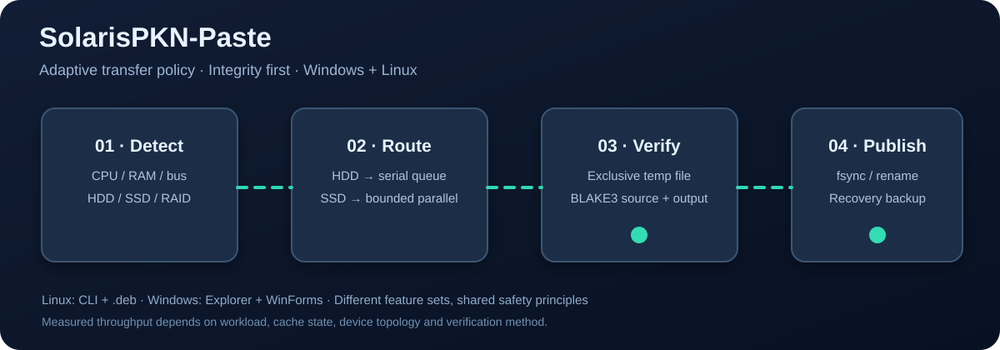
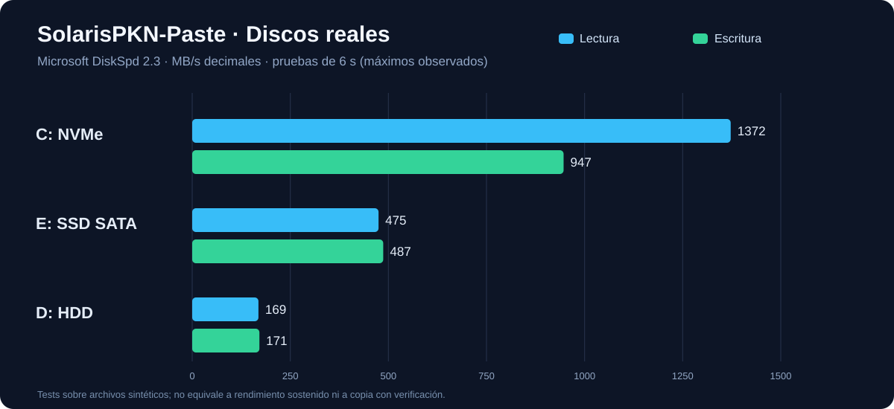
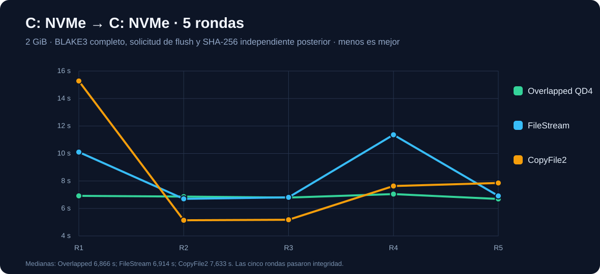
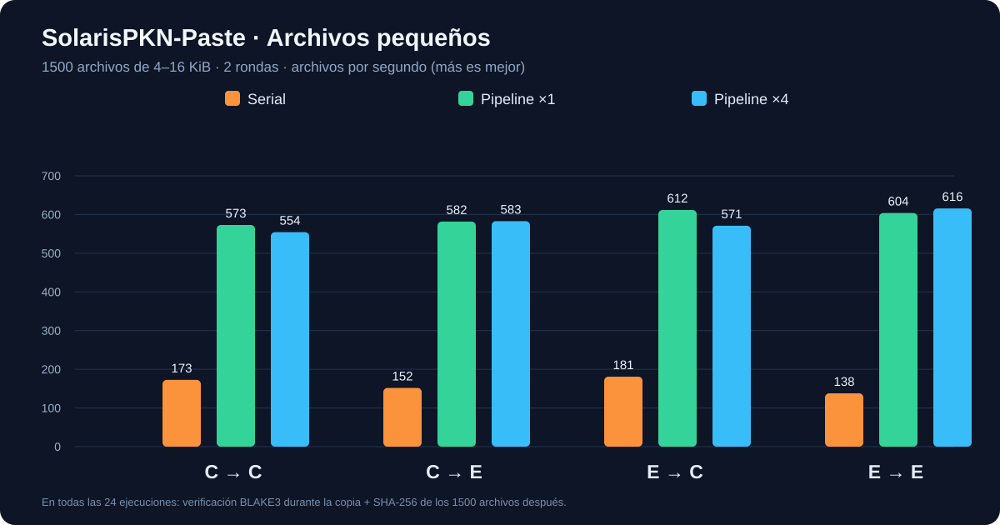

# ⚡ SolarisPKN-Paste

**[English](README.md) | [Español](README.es.md)**

> Experimental preview. Not production-ready. A standalone module of [SolarisPKN-OS](../), alongside [SolarisPKN-Verity](../solarispkn-verity/). SolarisPKN-OS is an R&D collection, not a complete operating system.

Hardware-aware, integrity-verified file copying with **separate** Windows and Linux implementations.

| Platform | Features | Status |
|---|---|---|
| 🪟 Windows 10/11 | Native .NET 10 WinForms, classic Explorer context menu, BLAKE3, recovery, graphs, USB assistant | Windows 0.2.0-alpha.8 baseline; additional code remains experimental |
| 🐧 Debian / Ubuntu | Python 3 CLI, BLAKE3 through b3sum, staging/atomic rename, conservative disk strategy | Linux 0.3.0-alpha.1; Debian 13 tested; Ubuntu runtime pending |

## 🧠 Copy pipeline

1. **Detect:** CPU, RAM, HDD/SSD, interface and visible RAID members. Any mechanical disk takes priority. An unknown drive uses conservative serial copying; confirmed SSD-only paths may parallelize within resource limits.
2. **Transfer:** Linux copies to a newly created staging file, using buffered I/O or Linux copy_file_range. Windows maintains distinct FileStream/OVERLAPPED/CopyFile2 and tiny-file engines.
3. **Verify:** BLAKE3 source and staged destination, independently, before publication. Linux requires the system b3sum command; --hash sha256 is an **explicit** alternative, never a silent substitution.
4. **Publish:** Linux flushes staged data, updates basic mode/timestamps, uses atomic rename and directory fsync. Existing files require --overwrite, which preserves an earlier version under .solarispkn-recovery.

**Scope:** Linux has no Windows Explorer or WinForms GUI integration. Linux does **not yet** fully preserve POSIX ACL, xattrs, SELinux labels, hardlinks, sparse layout or complete directory rollback. RAID queuing does not defragment data.

## 🪟 Windows build / installation

Requires Windows 10/11 x64 and .NET 10 SDK:

~~~powershell
dotnet restore .\src\SolarisPKN.Paste.csproj
dotnet publish .\src\SolarisPKN.Paste.csproj -c Release -r win-x64 --self-contained true -p:PublishSingleFile=true -p:IncludeNativeLibrariesForSelfExtract=true -o .\out\windows
.\out\windows\SolarisPKN-Paste.exe --selftest-headless
.\out\windows\SolarisPKN-Paste.exe --settings
# Installs per-user classic Windows Explorer commands:
.\out\windows\SolarisPKN-Paste.exe --install
# Uninstall the Explorer integration:
.\out\windows\SolarisPKN-Paste.exe --uninstall
~~~

Windows 11 may require **Show more options**. The installed alpha.8 was not overwritten with the experimental builds.

### 🔌 USB Advisor (Windows experimental)

The optional tray assistant detects actual USB link speed and verified accessible free connectors. A SuperSpeed-capable device running at 480 Mb/s could use a 5,000 Mb/s port; the 4.52 Gb/s gap is **only theoretical link signaling capacity**, not guaranteed transfer speed. Small Solaris popup, per-device/global opt-out, manually confirmed safe eject for uniquely recognized removable USBSTOR. Physical unplug/reconnect QA pending.

## 🐧 Debian and Ubuntu: build a .deb

Needs Python 3.10+, b3sum (from distro packages) and dpkg-deb for packaging. Tested on **Debian 13 Trixie in WSL2**; Ubuntu packaging dependencies are available but a full installation test is pending.

~~~bash
cd solarispkn-paste
bash linux/packaging/build-deb.sh
sudo apt install ./dist/solarispkn-paste_0.3.0~alpha1-1_all.deb
solarispkn-paste --version
solarispkn-paste profile "$HOME"
solarispkn-paste copy ~/Downloads/source.bin ~/Videos/source.bin
solarispkn-paste copy ~/Documents /mnt/backup --dry-run
solarispkn-paste copy ~/Documents /mnt/backup
solarispkn-paste copy ~/notes.txt ~/backup/notes.txt --overwrite
solarispkn-paste benchmark --root "$HOME" --size-mib 16 --rounds 3
~~~

The package installs /usr/bin/solarispkn-paste and a Python module; **no daemon, autostart, GUI, kernel module or Explorer integration**. Existing destination files are protected by default. A source/destination symbolic link is rejected. If a batch fails, already verified files and backups stay for inspection—**not a transactional rollback**. WSL2 cannot reliably reveal the host HDD/SSD behind a VHDX; unknown media is processed conservatively.

## 📊 Windows benchmark results (November 2026)

Synthetic local tests on Intel i3-10105, WD PC SN530 NVMe, Gigabyte SATA SSD and Toshiba HDD. **These results describe Windows engines, not the new Linux CLI.**

### Microsoft DiskSpd, six-second file benchmarks

| Drive | Observed read | Observed write |
|---|---:|---:|
| NVMe | 1,372.41 MB/s | 946.51 MB/s |
| SATA SSD | 474.83 MB/s | 486.89 MB/s |
| HDD | 168.82 MB/s | 171.27 MB/s |

Short runs do not establish sustained write speeds.

### Same NVMe, 2 GiB copy, five runs per engine

| Engine | Median | Best | Worst |
|---|---:|---:|---:|
| OVERLAPPED QD4 | **6.866 s** | 6.692 s | 7.047 s |
| FileStream | 6.914 s | 6.699 s | 11.364 s |
| CopyFile2 | 7.633 s | 5.141 s | 15.275 s |

Times include copying, flush and BLAKE3. Independent SHA-256 rehash was performed **outside** timings. OVERLAPPED was more consistent in this small sample, but FileStream's median was within 1%.

### 1,500 tiny files, 4–16 KiB, two passes per route/mode

| Route | Serial | Pipeline 1 writer | Pipeline 4 writers |
|---|---:|---:|---:|
| NVMe → NVMe | 172.6 files/s | **573.0** | 554.3 |
| NVMe → SATA | 151.8 | 581.9 | **582.9** |
| SATA → NVMe | 180.9 | **611.6** | 571.0 |
| SATA → SATA | 137.9 | 604.0 | **615.9** |

All 24 primary trials included BLAKE3 and a separately verified SHA-256 of all output files. Maximum observed improvement: **4.47×** vs serial for this small-file workload, **not universal FastCopy/TeraCopy superiority**. Seven more Windows SSD/HDD path cases passed hash checks. Mixed RAID was tested using synthetic policy objects, not physical RAID hardware.

[Performance report](docs/INFORME-INTEGRAL-IO-WINDOWS-WSL-2026-11-07.md) · [CPU/RAID profiler](docs/AUTOPERFIL-HARDWARE-RAID-2026-11-07.md) · [USB Advisor](docs/SOLARIS-USB-ADVISOR-2026-11-07.md) · [Acceptance matrix](tests/TEST-MATRIX.md).

## 🧪 Testing

~~~bash
cd linux
python3 -m unittest discover -s tests -p 'test_*.py' -v
make check
~~~

Still pending: Ubuntu installation, Windows 11 interactive UI QA, Linux ACL/xattr fidelity, power-loss/cancellation recovery, USB hotplug/eject, hardware RAID adapters and sustained high-volume benchmarks.

### Layout

~~~text
solarispkn-paste/
├── src/           Windows WinForms/.NET 10
├── linux/         Native CLI, .deb builder and tests
├── docs/          Audits, SVG charts, GIF demonstration
├── tests/         Acceptance plan
├── README.md      English primary documentation
└── README.es.md   Spanish translation
~~~

**Licensing:** Third-party Blake3 and b3sum retain upstream terms. No independent SolarisPKN-Paste redistribution license has been selected yet; public repository visibility does not itself grant reuse rights. **Do not use an alpha as the only copy of critical data.**
