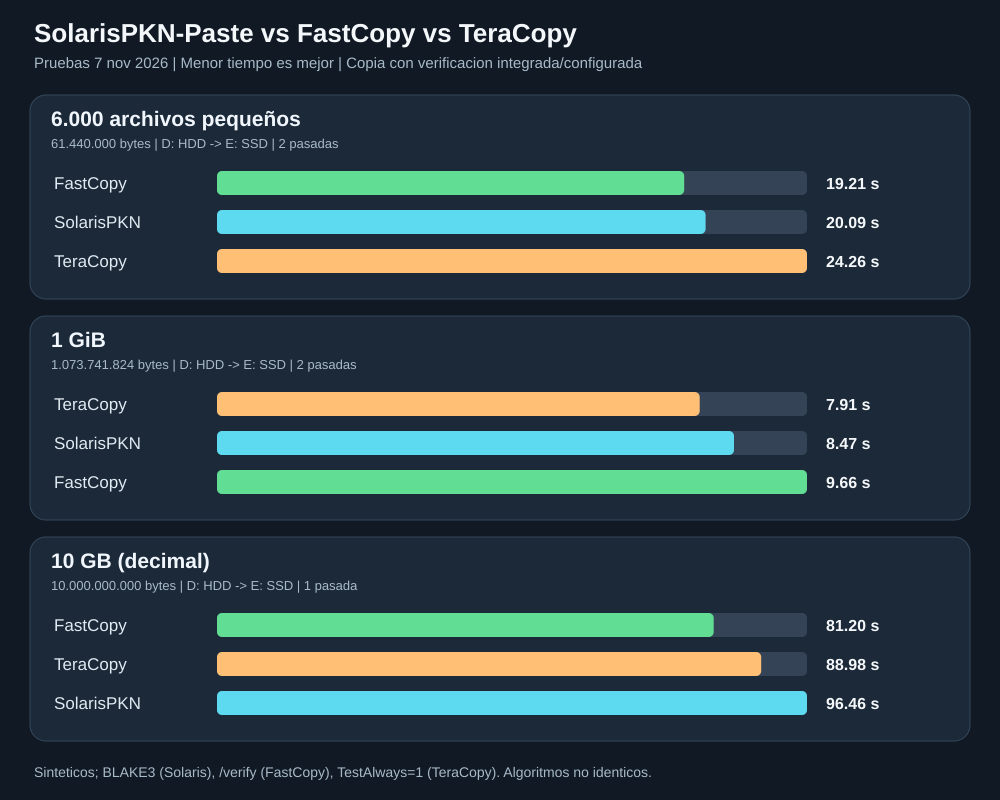

# SolarisPKN-Paste frente a FastCopy y TeraCopy

**Fecha:** 2026-11-07 (Argentina). **PC:** Intel i3-10105, 40 GiB RAM; D: Toshiba HDD NTFS (64 KiB clusters) hacia E: Gigabyte SSD NTFS (4 KiB clusters). Equipo con otras aplicaciones reducidas por el usuario, sin forzar limpieza de caché ni desactivar Defender.

## Resultados medidos

Los segundos son **tiempo de proceso de copia más la verificación configurada en cada aplicación**. Los chequeos externos SHA-256 fueron *fuera del cronómetro*.

| Escenario | Programa | Prueba 1 | Prueba 2 | Promedio | Verificación |
|---|---|---:|---:|---:|---|
| 6.000 archivos (61.440.000 B) | **FastCopy 5.12.0** | 19,294 s | 19,128 s | **19,211 s** | `/verify`, logfile sin errores |
| | SolarisPKN-Paste | 20,652 s | 19,524 s | 20,088 s | BLAKE3 origen+temporal, publicación tras verificar |
| | TeraCopy portátil | 24,701 s | 23,815 s | 24,258 s | `TestAlways=1` en instancia portátil |
| 1 GiB (1.073.741.824 B) | **TeraCopy portátil** | 8,047 s | 7,766 s | **7,907 s** | `TestAlways=1` |
| | SolarisPKN-Paste | 11,682 s | 5,254 s | 8,468 s | BLAKE3 completo |
| | FastCopy 5.12.0 | 10,069 s | 9,258 s | 9,664 s | `/verify` |
| 10 GB (10.000.000.000 B) | **FastCopy 5.12.0** | 81,202 s | — | **81,202 s** | `/verify` |
| | TeraCopy portátil | 88,976 s | — | 88,976 s | `TestAlways=1` |
| | SolarisPKN-Paste | 96,457 s | — | 96,457 s | BLAKE3 completo |

**Interpretación:** FastCopy lideró los 6.000 archivos por un 4,4 % frente a Solaris. TeraCopy tuvo el mejor promedio de 1 GiB, pero el segundo ensayo de Solaris (5,254 s) muestra fuerte variación por caché/actividad. En 10 GB FastCopy fue 15,255 s más rápido que Solaris; solo hay una pasada por herramienta, insuficiente para generalizar.

## Procedimiento de integridad y comparabilidad

- Mismo usuario de sesión Windows, misma fuente y destino en raíces de benchmark con **marcador de propiedad**. Las nueve pruebas iniciales se ejecutaron en orden alternado; luego una segunda ronda inversa para 1 GiB. Hubo dos pasadas por programa para 6.000 archivos y 1 GiB, una sola pasada en 10 GB.
- Solaris: BLAKE3 de origen y del temporal verificado antes de publicar el archivo, con staging. FastCopy: opción `/verify` confirmada por registro de ejecución. TeraCopy: ejecutable portátil independiente con `TestAlways=1` y `HashName=xxHash3-64`; su uso exacto del algoritmo durante cada fase no se verificó mediante traza interna, por lo que **no debe suponerse semántica de verificación idéntica**.
- FastCopy y TeraCopy: **48 archivos pequeños** con SHA-256 independiente, **archivo completo de 1 GiB** con SHA-256 y **32 fragmentos de 1 MiB repartidos a lo largo de 10 GB**, todos fuera del tiempo de copia. El muestreo en 10 GB no equivale a verificar los 10 GB con SHA-256.
- El resultado incluye tiempo de inicio/cierre de proceso y verificación propia, no mide exclusivamente escritura física ni es una comparación de algoritmos hash idénticos. Se conservaron logs y JSON por corrida en `D:\researchs\SolarisPKN-Paste\reports\competitive-20261107\`.

## Optimización NTFS: resultado experimental

Se probaron cambios al pipeline de archivos pequeños: eliminar consultas `File.Exists/Directory.Exists` redundantes antes de `File.Move(overwrite:false)` y fijar fecha de modificación sobre un `SafeFileHandle` ya abierto.

| Motor | Segundos medidos |
|---|---|
| Anterior, 4 escritores/verificadores | 20,909 / 20,158 |
| Optimización conjunta | 21,070 / 19,743 |
| Solo omitir consultas redundantes | 18,429 (una pasada) |
| Solo fecha mediante handle | 18,689 (una pasada) |

No existe una ventaja repetible acreditada; **desactivado por defecto**. La integridad BLAKE3 continúa obligatoria.

## E/S superpuesta para grandes archivos

Implementación experimental `OverlappedCopyEngine.cs`, basada en `.NET RandomAccess` con 2, 4 u 8 E/S pendientes, bloques de 1–4 MiB, hash origen ordenado, vaciado y BLAKE3 de destino; **solo opt-in**.

En 1 GiB, profundidad 8 tardó 5,255 / 5,818 s frente a 5,625 s de un baseline intercalado. Profundidad 4 tardó 7,272 s. En una pasada anterior con 10 GB el prototipo de profundidad 4 terminó en 89,731 s, frente a 91,829 s del motor anterior: diferencia menor que la varianza conocida. No activar por defecto todavía.

## Instrumentación ETW

Windows Performance Recorder permitió registrar `FileIO` y `DiskIO`; una transferencia de 6.000 archivos alcanzó 24,348 s con traza intensiva. Los primeros 25.000 eventos se resumieron por GUID de proveedor y opcode, sin decodificar semánticamente los eventos (por lo tanto **no demuestra aún qué operación NTFS domina**). El ETL bruto de 2.177.892.352 bytes se eliminó tras conservar el resumen en JSON. El coste de instrumentar puede distorsionar el rendimiento.

## Visualización en tele SAMSUNG

Se confirmó `MONITOR\SAM07C0` = `\\.\DISPLAY5`, 1280×720 en sesión de usuario. Panel Windows Forms en esquina superior derecha con barras en tiempo real para los tres escenarios, posición de pantalla (2150, 82), 472×337, opacidad 86 %, `WS_EX_NOACTIVATE` y clics transparentes. Lee exclusivamente registros y resultados cada 2,5 s y se cierra automáticamente 5 minutos después de acabar. No cambia resolución, foco ni controla la película.

## Decisión

**Mantener la versión instalada 0.2.0-alpha.8**: los cambios en desarrollo no han superado el criterio de mejora reproducible más integridad/recuperación. Priorizar perfilado específico de latencias NTFS sin cargar el sistema con ETW continuo y optimización de archivos grandes con medidas de caché fría/caliente. Nada se publicó ni instaló automáticamente; el código experimental está en el repositorio local.
