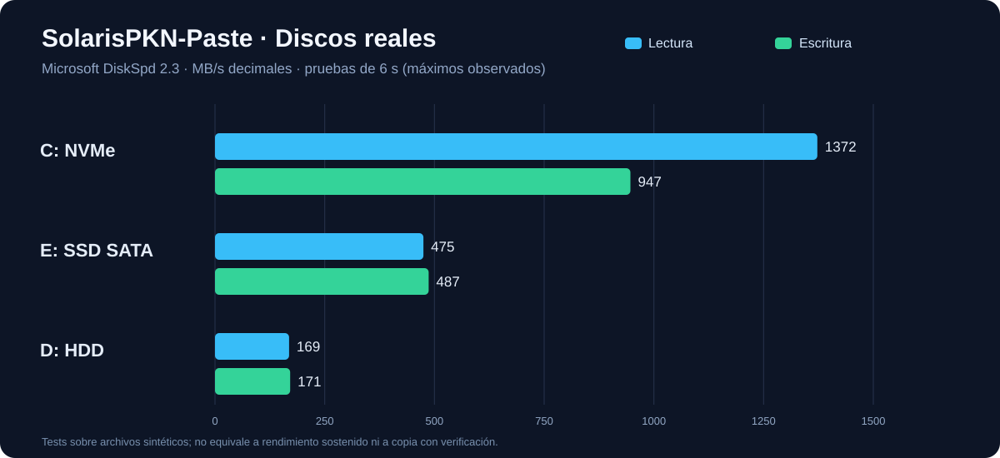
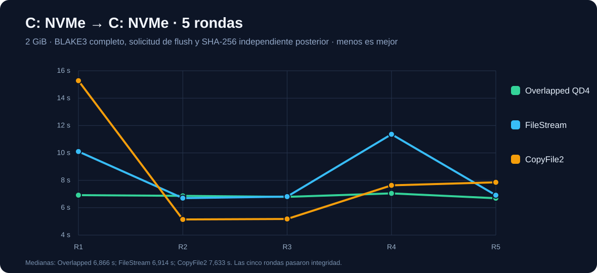
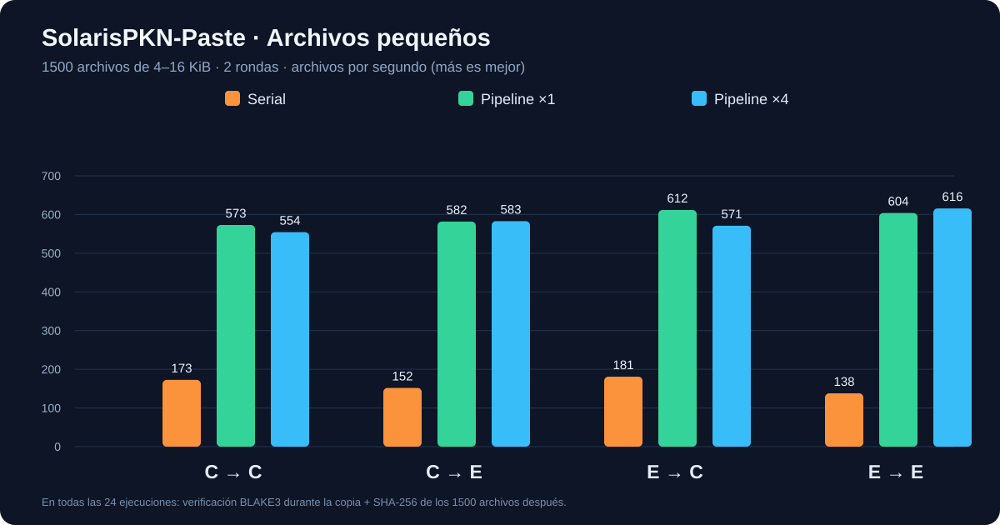

# 🚀 SolarisPKN-Paste — Informe integral de rendimiento Windows + Linux WSL2

**Fecha:** 7 de noviembre de 2026 (Argentina, UTC-3)
**Entorno:** SolarisPKN-PC, Windows 10 IoT Enterprise LTSC 19044, i3-10105 (4C/8T), 42 GiB RAM aprox.
**Estado:** investigación y código candidato experimental. **No instalado ni promovido sobre alpha.8.**

## Resumen de las mediciones

Se ejecutaron **86 casos/perfiles** de prueba acotados en esta sesión: 22 perfiles sintéticos de almacenamiento Windows DiskSpd, 16 ejecuciones de copia grande dentro de NVMe, 28 copias de archivos pequeños en SSD y 20 experimentos Linux WSL2. Todas las mediciones contabilizadas finalizaron sin error y con las verificaciones aplicables. No se incluyen pruebas previas ni una modalidad experimental antigua que no terminó con reporte válido. Esto **no sustituye** la QA completa de ACL/EFS/ADS, fallos eléctricos, copias reales, cancelación ni benchmarks en Linux nativo.

**Hallazgos:**
1. C: NVMe alcanzó 1.372 MB/s de lectura secuencial y 947 MB/s de escritura secuencial en bloques de 1 MiB; la escritura coincide con el pico anunciado. La lectura está por debajo de los 2.400 MB/s comerciales y no hay causa demostrada todavía.
2. E: SATA alcanzó 475 MB/s lectura y 487 MB/s escritura en tests cortos. D: HDD ~169/171 MB/s secuenciales y **138 IOPS de lectura aleatoria 4 KiB**: con archivos pequeños hay que reducir movimientos del cabezal y metadatos; perseguir MB/s secuenciales es una métrica engañosa.
3. En copia C:→C: de 2 GiB con BLAKE3, el motor Overlapped 2MiB/QD4 fue el **más estable en cinco rondas**, mediana 6,866s. FileStream mediana 6,914s; CopyFile2 7,633s pero muy variable. La diferencia de mediana entre los dos primeros es pequeña (0,7 %), no justificaría cambiar el motor por velocidad pura sin QA adicional.
4. El pipeline para 1500 archivos de 4–16KiB aceleró el tiempo de ejecución entre **3,32× y 4,47×** respecto del motor serial, según la combinación de unidades, manteniendo BLAKE3 interno y SHA-256 externo para todos los archivos. Un escritor rindió mejor para destino NVMe C:; SATA E: mostró empate/práctica igualdad o leve ventaja de cuatro escritores.
5. Linux WSL2 Debian sobre ext4 tiene un rendimiento de creación/copia de archivos diminutos mucho mayor que Linux vía DrvFS/montajes de Windows, pero las comparaciones son entre **caché/ext4 VHDX alojado en HDD D:** y **NTFS vía DrvFS**. No son pruebas Linux instaladas directamente en NVMe o SATA. Un resultado de 10 GB/s buffered en ext4 es **RAM**, no velocidad del disco.

## 🗺️ Hardware detectado

| Volumen | Modelo | Medio | Windows BUS | NTFS cluster | Estado |
|---|---|---|---|---:|---|
| C: | WD PC SN530 SDBPNPZ-256G-1002, 256 GB | NVMe PCIe Gen3 x4 | NVMe | 4 KiB | Healthy |
| E: | Gigabyte GP-GSTFS31480GNTD, 480 GB | SATA SSD (controlador reporta RAID) | RAID | 4 KiB | Healthy |
| D: | Toshiba HDWQ140, 4 TB | HDD (controlador reporta RAID) | RAID | 64 KiB | Healthy |

El controlador NVMe de Windows mostró enlace **PCIe Gen 3 x4**, sin reducción visible de líneas. WD reportó 29–32 °C durante pruebas; temperatura de E/D no disponible (el contador devolvió 0, **no significa 0 °C**). TRIM habilitado, BitLocker deshabilitado en C. C: conserva unos 25,7 GiB, solo ~10,8 % del volumen, y el fixture C de 2 GiB quedó dividido en 74 extensiones NTFS; son factores a investigar, no diagnósticos causales.

## 1. Rendimiento sintético de los tres discos

Microsoft DiskSpd 2.3, ejecutable firmado por Microsoft, sobre archivos sintéticos temporales, jamás en unidades RAW. Tests de 6 s, con I/O sin caché de software y, para escritura, política de write-through. MB/s decimales.

| Perfil | C: NVMe | E: SATA | D: HDD |
|---|---:|---:|---:|
| Lectura secuencial 1 MiB QD1 | 1.300,23 | 434,81 | 168,82 |
| Lectura secuencial 1 MiB QD8 | **1.372,41** | **474,83** | 158,86 |
| Escritura secuencial 1 MiB QD1 | 917,85 | 434,46 | 170,39 |
| Escritura secuencial 1 MiB QD8 | **946,51** | **486,89** | **171,27** |
| Lectura aleatoria 4KiB QD1 (IOPS) | 10.179 | 7.231 | **138** |
| Escritura aleatoria 4KiB QD1 (IOPS) | 26.291,5 | 17.295 | 437,83 |

Solo C: además: QD32 lectura 128KiB=1.079,66MB/s, escritura 128KiB QD32=944,90MB/s, random read 4K QD32=10.652,5IOPS y random write 4K QD32=28.061IOPS.

**Limitación:** muestras cortas con mismo archivo 1–2 GiB no prueban velocidad sostenida de toda la NAND, caché pseudo-SLC agotada ni condiciones comerciales de profundidad de cola/hilos. El WD 256GB tiene anuncio de ~950MB/s pico escritura y valor sostenido del fabricante en otra carga mucho más bajo (~220MB/s). No debe deducirse que 947MB/s persistirá sobre decenas de GiB.

**Evidencia:** D:\researchs\SolarisPKN-Paste\reports\nvme-physical-20261107\summary.json y D:\researchs\SolarisPKN-Paste\reports\diskspd-e-d-20261107\ (JSON+XML).

## 2. NVMe C: → NVMe C:, archivos grandes

Archivo sintético de 2 GiB. Copia temporal, flush y BLAKE3 del destino incluidos en el cronómetro, seguido de SHA-256 completo externo. Cinco pruebas por motor, todas PASS. Tiempos en segundos (menor mejor):

| Motor | R1 | R2 | R3 | R4 | R5 | Mediana | Rango |
|---|---:|---:|---:|---:|---:|---:|---:|
| Overlapped 2 MiB QD4 | 6,916 | 6,866 | 6,793 | 7,047 | 6,692 | **6,866** | **0,355** |
| FileStream | 10,104 | 6,699 | 6,810 | 11,364 | 6,914 | 6,914 | 4,665 |
| CopyFile2 buffered + flush | 15,275 | 5,141 | 5,176 | 7,633 | 7,856 | 7,633 | 10,134 |

El mismo motor CopyFile2 osciló entre 5,14 y 15,28 s, por lo que un récord de una sola ronda sería engañoso. El modo Overlapped destaca por estabilidad. **Selección adaptativa experimental de la ruta completa:** se activó Overlapped para una copia NUEVA C:→C: de 2 GiB, seleccionada realmente en PastePlan/PasteQueue, con 7,876s, BLAKE3+SHA-256 PASS. Es una observación adicional bajo otra carga del sistema, no una sexta ronda del ensayo aislado.

**Evidencia:** D:\researchs\SolarisPKN-Paste\reports\nvme-physical-20261107\engine-five-rounds-summary.json y engine-adaptive-r1.json.

## 3. 1500 archivos pequeños en NVMe y SATA

Archivos de 4/8/12/16 KiB, 15.360.000 bytes en total. Se mide solo la etapa Execute de SolarisPKN-Paste; análisis de plan y SHA-256 externo quedan separados. **Todas las 24 ejecuciones principales PASS**, incluyendo BLAKE3 por archivo y SHA-256 externo íntegro de 1500 pares por ejecución. Dos rondas alternadas; promedio de ambas, expresado en segundos:

| Dirección | Serial | Pipeline 1 escritor | Pipeline 4 escritores | Perfil recomendado |
|---|---:|---:|---:|---|
| NVMe C→C | 8,690 | **2,618** | 2,706 | 1 escritor (3,32× vs serie) |
| NVMe C→SATA E | 9,880 | 2,578 | **2,574** | 4 / 1 equivalentes |
| SATA E→NVMe C | 8,292 | **2,452** | 2,627 | 1 escritor (3,38× vs serie) |
| SATA E→SATA E | 10,881 | 2,484 | **2,436** | 4 escritores (4,47× vs serie) |

Con destino NVMe el escritor único fue consistente; en SATA las diferencias entre 1 y 4 son pequeñas y dos rondas no permiten generalizar universalmente. El pipeline sí supera holgadamente el modo serial en los cuatro casos.

**Verificación de la ruta adaptativa real** (otras cuatro copias, PASS con SHA-256):
- C→C: 2,700s y 1 escritor efectivamente elegido.
- E→C: 2,611s y 1 escritor.
- C→E: 2,634s y 4 escritores.
- E→E: 2,564s y 4 escritores.

**Evidencia:** D:\researchs\SolarisPKN-Paste\reports\ssd-small-20261107\all-mode-summary.json y *-adaptive-r1.json.

## 4. Linux WSL2 Debian, ext4/DrvFS

Distro: Debian WSL2, kernel 6.6.87.2. Ext4 dentro de VHDX en D:\Yocto-Lab\Debian (físicamente respaldado por HDD D). Root Linux en /dev/sdd ext4. /tmp es **tmpfs RAM** y NO se utilizó para las pruebas. Los montajes /mnt/c, /mnt/d, /mnt/e son DrvFS sobre Windows, no discos Linux nativos. El acceso requirió ejecutar desde la sesión interactiva del usuario porque WSL rechaza SYSTEM.

### Copia de 512 MiB desde ext4 (MB/s, incluyendo fsync del destino)

| Destino | Python sin búfer (r1) | Python buffered (r2) |
|---|---:|---:|
| /mnt/e · SATA | 138,95 | 153,57 |
| /mnt/c · NVMe | 191,40 | 185,36 |
| /mnt/d · HDD | 101,77 | 97,19 |
| ext4 · mismo VHDX | 148,08 | 144,75 |

Las ocho copias pasaron SHA-256 del archivo entero. Son lecturas desde un origen ext4 que pudo permanecer parcialmente en caché: >170 MB/s al copiar hacia C no demuestra que el HDD del VHDX lea físicamente a esa velocidad.

### 1500 archivos pequeños, 4 KiB, sin fsync por archivo

| Destino | Archivos/s |
|---|---:|
| ext4 WSL2 (VHDX) | **18.155,78** |
| /mnt/c NVMe NTFS/DrvFS | 174,06 |
| /mnt/e SATA NTFS/DrvFS | 156,48 |
| /mnt/d HDD NTFS/DrvFS | 155,89 |

Las cuatro copias tuvieron SHA-256 íntegro sobre el conjunto de archivos. **No es una comparación de durabilidad ni un benchmark de IOPS físicos**: la extrema rapidez de ext4 está influida por caché, y DrvFS tiene coste de traducción de metadatos.

### dd lectura secuencial de 512 MiB, con y sin O_DIRECT

| Fuente | O_DIRECT reportado | Buffered reportado |
|---|---:|---:|
| ext4 WSL2 | 160,36 MB/s | **10.581 MB/s (RAM/caché)** |
| /mnt/e DrvFS | 294,37 MB/s | 249,97 MB/s |
| /mnt/d DrvFS | 292,19 MB/s | 306,97 MB/s |
| /mnt/c DrvFS | 309,24 MB/s | 298,15 MB/s |

Estos ocho comandos terminaron exit=0. En DrvFS, Linux O_DIRECT no garantiza atravesar todas las capas de caché de Windows: por ejemplo /mnt/d da 292 MB/s, más que el HDD en DiskSpd Windows. No atribuir esa cifra a rendimiento físico real.

**Evidencia:** D:\researchs\SolarisPKN-Paste\reports\linux-wsl-20261107\sequential.json, small.json y direct.json, junto a -exit.json y bitácoras.

## 5. Nuevo diseño adaptativo implementado en código

Versión compilada candidata: D:\researchs\SolarisPKN-Paste\builds\adapted-nvme-policy-candidate-20261107\SolarisPKN-Paste.exe

En el código fuente del proyecto se incorporaron **tres interruptores experimentales separados, TODOS false por defecto**, disponibles en la ventana Ajustes de la compilación candidata:

1. **AdaptiveVerifiedSolidStateCopy:** CopyFile2 buffered + flush + BLAKE3, archivo nuevo >=1 GiB, discos SSD confirmados distintos y NTFS. Validado en C↔E en el laboratorio anterior.
2. **AdaptiveNvmeSameDiskOverlapped:** Overlapped de 2MiB/QD4 en archivo nuevo >=2GiB dentro del mismo NVMe físico/volumen NTFS confirmado, sin Cut ni preferencia explícita por CopyFile2. Validado en ruta completa C→C con BLAKE3+SHA256.
3. **AdaptiveNvmeSmallFileWriters:** si el usuario dejó escritores=0 (auto), al detectar destino NVMe NTFS y origen SSD confirmado, usa 1 escritor del pipeline pequeño. Con SATA E mantiene 4. Validado en cuatro direcciones con BLAKE3 y SHA256.

El código evita tratar topologías desconocidas como SSD: no se activa el modo optimizado cuando Windows no confirma seek penalty y bus. El informe D:\researchs\SolarisPKN-Paste\reports\device-profile-20261107.json documenta C:NVMe, D:HDD, E:SATA/RAID por controlador.

**Archivos de origen modificados/añadidos en el árbol de pruebas:** PasteEngine.cs, Program.cs, StorageTopology.cs, NativeWindowsCopy.cs, BenchmarkRunner.cs, SsdBenchmarkRunner.cs, NvmeSameDiskRunner.cs, SmallSsdBenchmarkRunner.cs y DeviceProfileDiagnostic.cs. Además, los scripts de laboratorio, registros JSON/XML y ejecutables experimentales quedan en D:\researchs\SolarisPKN-Paste.

**Compilación Release Windows x64 auto-contenida:** PASS. **Selftest headless:** exit code 0. **Pruebas completas de interfaz/compatibilidad Windows 11, ADS/ACL/EFS, cut/overwrite/rollback y fallos de energía:** pendientes. No reemplazar la alpha.8 hasta aprobar la matriz de aceptación.

## 6. Riesgos y próximos pasos

1. Investigar lectura NVMe 1,37GB/s vs 2,4GB/s anunciado: comprobar dispersión/latencia con múltiples archivos, filtro antivirus (SIN desactivar protección), controlador/firmware, carga real y espacio libre. No adjudicar culpa a un factor sin evidencia.
2. Repetir la prueba de archivos pequeños con 6000 y 30.000 archivos, distintos rangos de 0–64KiB y distribuciones reales de directorios, tanto en frío como en caliente, con cinco rondas si se va a activar por defecto.
3. Agregar telemetría de latencia P50/P95 por I/O, IOPS de lectura/escritura y núcleos por proceso, caché y CPU, con ETW filtrado por PID y logs mínimos. Eliminar dependencias de contadores Windows que devuelven 0 sin soporte.
4. No perseguir MB/s secuenciales HDD para miles de archivos: reducir seeking con SameHddBatchEngine (su ensayo anterior mostró mejora importante), previo QA de fallos, cambio concurrente y durabilidad.
5. Completar validaciones de metadatos, enlaces, archivos abiertos, seguridad, cancelación y recuperación; solo después ofrecer promoción a versión estable. Nunca eliminar contenido personal para agrandar caché SLC.

## Seguridad y cierre de las pruebas

- No se escribió a volúmenes RAW, particiones de sistema ni rutas de usuario.
- Solo se usaron carpetas específicas con sentinel y archivos sintéticos; no se desactivó Windows Defender ni se cambió BIOS/firmware.
- Se verificó la eliminación completa de datasets en C:, E:, D: y en WSL2 Debian. Se desregistraron las tareas temporales de ejecución WSL.
- El ejecutable instalado D:\Programas\SolarisPKN-Paste\SolarisPKN-Paste.exe (alpha.8) no se reemplazó.
- Los tres discos siguen reportando HealthStatus Healthy.
- Espacio libre final Windows: C ~27,60 GB; D ~1,878 TB; E ~175,39 GB.

*La investigación produce evidencia de rendimiento, no certificación de integridad ante pérdida de energía ni garantía de alcanzar cifras de catálogo en todos los archivos.*
