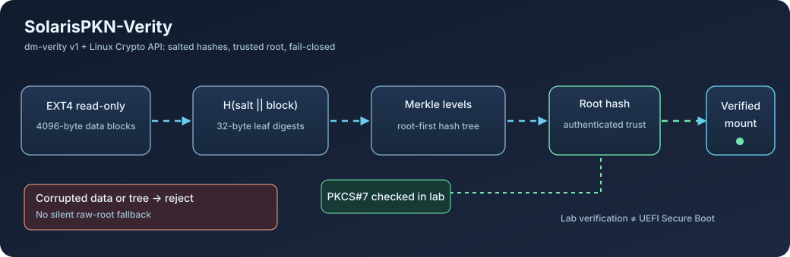

# SolarisPKN-Verity — integration and regression evidence (EN)

**Documented source:** `0.6.0-rc1` · **Status:** experimental, not production certified · **Updated:** 2026-10-26

[Versión en español](INTEGRATION-AND-REGRESSIONS.es.md) · [Release gate](../RELEASE-STATUS.md) · [Runnable tests](../cli/tests/test_verity_regressions.py)

> **Scope:** only functionality, integration, interoperability and bug-fix evidence. Performance benchmarks, timing, throughput figures and private lab data are intentionally excluded. This project adapts an existing BLAKE3 implementation for the Linux Crypto API and upstream dm-verity; it neither defines a new hash function nor forks dm-verity.



## 1. Integration without patching dm-verity

```text
Immutable EXT4 image (4096-byte blocks)
    │
    ├── dm-verity format 1 tree builder
    │       H(salt || block) → leaf digests → Merkle levels → root hash
    │
    └── Data device ─────────┐
                              ├─ upstream dm-verity (Linux kernel)
Merkle tree / hash device ───┘          │
                   Linux Crypto API: blake3 (shash) or sha256
                                       │
                           Verified read-only EXT4
```

A Merkle root **does not authenticate itself**. A boot trust chain must authenticate the root hash (for example, a PKCS#7 signature checked against a trusted key). The lab exercised mandatory signatures; it did **not** validate end-to-end UEFI Secure Boot.

### Merkle format contract

| Property | Implemented choice | Purpose |
|---|---|---|
| Format | dm-verity v1 | Interoperability with upstream device-mapper |
| Data/hash blocks | 4096 bytes each | Avoid block-geometry and mount mismatches |
| Digest length | 32 bytes | 128 digests per 4 KiB hash block |
| Block hashing | `H(salt || block)` | Match dm-verity expected digest order |
| Tree ordering | Root level first in on-disk tree | Match the implemented Merkle layout |
| Negative checks | Reject changed data, tree or root | No silent acceptance |

The image builder rejects inputs not aligned to 4096 bytes. Local manifests may contain absolute machine paths: **do not upload the original manifests, images, private keys or certificates**.

## 2. Observed incompatibilities, causes and fixes

| Observation | Confirmed cause / diagnostic boundary | Fix or mitigation | Status |
|---|---|---|---|
| Merkle hash verified, but EXT4 would not mount | EXT4 used **1024-byte blocks** while the dm-verity mapping used **4096-byte blocks** | Regenerate EXT4 using consistent 4096-byte blocks, rebuild the entire Merkle tree and mount `ro,noload` | **Validated** in lab |
| Early module depended on external `ahash` provider | Prior prototype targeted a different kernel/experimental provider | Build a self-contained **Crypto API `shash`** module for Linux 6.18 without modifying dm-verity | **Validated** in QEMU, experimental |
| SIMD instruction availability differed across CPUs | Guest CPUID did not expose all x86 features | Dispatch among portable/SSE2/SSE4.1/AVX2 implementations and use safe fallback; AVX-512-requested tests **did not execute AVX-512** | **SSE2/SSE4.1/AVX2 executed**; AVX-512 open |
| `objtool` return mitigation warnings | Assembly/kernel integration needed return-thunk consistency | Rework return-path compatibility while retaining kernel mitigations, rebuild and inspect | **Previously observed warnings resolved** in tested candidate |
| Injected kernel allocation failure | Controlled debug ENOMEM injection, not necessarily a real BLAKE3 defect | Validate clean error handling and recovery under KASAN | **Bounded PASS**, not exhaustive memory safety proof |
| Initial KFENCE stress test reported FAIL | Test-harness shell quoting/output parsing, not a demonstrated kernel memory error | Correct harness and rerun | **75/75 cycles PASS** in revised experiment |
| Initial KASAN debug kernel did not boot | Debugging environment/kernel failure; no confirmed BLAKE3 root cause | Adjust debug setup and rerun | **Controlled KASAN/ENOMEM PASS** |
| Verified read-only root returned `Permission denied` | `fstab` and SysVinit configuration requested writable root | Map `/` to verified device, use `read-only-rootfs` and RO mounts | **Older functional lab fix** |
| `S1 respawning too fast`; `urandom` seed failed | Nonexistent `ttyS1` getty and seed file on RO root | Keep `ttyS0`, remove `S1` entry; use `/run` in lab | **Lab-only**: tmpfs seed is not persistent and is not production-safe |
| Invalid root, invalid signature or Merkle corruption | Root digest/tree or authenticated trust value does not match | Stop verified mount; never silently boot raw rootfs | **Negative test confirmed** |
| `shash export` larger than 64-byte context | Explicit experimental provider limitation | Reject unsupported state rather than truncate silently | **Known limitation**, API review pending |
| Scarthgap `meta-solarispkn-verity` and Wrynose crypto layer | Distinct `LAYERSERIES_COMPAT` values | Keep layers separate; test crypto layer in Wrynose first | **Cross-series integration still pending** |

The legacy `ahash` prototype and the current public `shash` candidate are **not the same revision**. Earlier SysVinit/read-only root fixes should not be represented as fully revalidated on 0.6.0-rc1.

## 3. Functional validation evidence (no speed measurements)

| Check | Recorded result | Supported interpretation |
|---|---|---|
| BLAKE3 kernel known-answer tests | **6/6** vectors for each requested portable, SSE2, SSE4.1, AVX2, auto and AVX-512 mode | Digest correctness in exercised paths; AVX-512 **fallback only**, not ISA execution |
| `shash` API lifecycle | Init/reuse/import/export/re-init/finalization markers: **PASS** | Tested API transitions behave as expected |
| KASAN + controlled ENOMEM | Corrected run **PASS**, no KASAN errors reported | Limited scope, not proof of all memory safety |
| KFENCE after harness correction | **75/75** cycles, no KFENCE errors reported | Limited sanitizer coverage |
| SHA-256/BLAKE3 Merkle tree | Full-tree/root validation and deliberate data/tree corruption rejected: **PASS** | Structural integrity for tested images |
| Lab mandatory PKCS#7 root signature | Untampered signed root mounted; wrong signed root and missing signature enforcement rejected | **Not** end-to-end UEFI Secure Boot |
| Real BLAKE3 dm-verity at 1 GiB and 512 MiB | **6/6**: valid images reached login; four corrupted data/tree cases logged device-mapper errors, failed the verified mount and did **not** reach login | Controlled QEMU TCG results; not full chain certification nor an attestation of every subsequent source revision |
| Post-mount corruption and additional CPU architectures | **Not yet validated** | Still required before any release claim |

These records establish **bounded functionality**, not universal robustness or certified production secure boot.

## 4. Reproduce offline Merkle checks without privileged devices

With Python 3, at the `solarispkn-verity/` root:

```bash
python3 -m unittest discover -s cli/tests -p 'test_verity*.py' -v
```

The BLAKE3 builder tests require the optional host-side Python `blake3` package. If unavailable, the existing test reports `SKIP`; a skipped check **must not be counted as PASS**.

Use a disposable, 4096-byte-aligned test image, never the running root filesystem:

```bash
python3 cli/tools/verity_image.py build \
  --image demo.img --tree demo.tree --manifest demo.json \
  --algorithm blake3

python3 cli/tools/verity_image.py verify \
  --image demo.img --tree demo.tree --manifest demo.json
```

The `table` command only prints a dm-verity mapping table: it does **not** create or mount devices. `sign-root` / `verify-signature` require operator-supplied OpenSSL key material that must **never be committed**.

## 5. Before production use

- Reproduce signed-root, corrupted data/tree and verified mount tests with **the exact released module build**.
- Detect corruption introduced *after* mounting, and ensure reads never return corrupted bytes silently.
- Review complete `shash` import/export and out-of-range-state handling.
- Build with the kernel's official Yocto toolchain and inspect ABI, symbols and mitigations.
- Exercise AVX-512 on supported hardware and expand architectural coverage to ARM64/RISC-V as appropriate.
- Verify UEFI/OVMF Secure Boot end-to-end with authenticated kernel, initramfs and command line.
- Verify licensing, attribution and segregation from third-party private artifacts.

**Publication boundary:** this repository contains **source and reproducible functional evidence only**. Host load tests, timing and speed comparisons are separate research and are not mirrored here.
